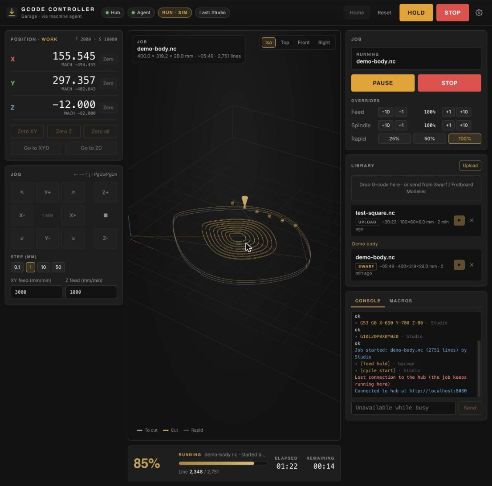

# GCode Controller

**A networked GRBL sender for hobby CNC.** Design on one Mac, run the machine from another, and watch
the same job live on both. It is built for a FoxAlien XE-Ultra (GRBL 1.1 over USB) and works with any
GRBL 1.1, grblHAL or FluidNC machine that talks the standard serial protocol.

> [!WARNING]
> **This is experimental software that moves a machine with a spinning cutter. You use it at your
> own risk.** Keep a hardware emergency stop within reach. Air-cut new jobs with Z zeroed above the
> stock, and never leave a running machine unattended. Provided under the MIT License **without
> warranty of any kind**.



## How it fits together

```
 Swarf / Fretboard ──HTTP POST──▶ ┌──────────── HUB (design Mac :8080) ────────────┐
 Browser upload ─────────────────▶│ file library · macros · state fan-out · UI      │◀── Browser (indoors)
                                  └───────────────▲─────────────────────────────────┘
                                                  │ WebSocket (agent dials out, reconnects, finds hub via Bonjour)
                                  ┌───────────────┴──── AGENT (garage Mac :8081) ───┐
 Browser (garage, localhost) ────▶│ GRBL streamer · machine state · same UI          │
                                  │ USB serial  |  built-in GRBL simulator           │
                                  └───────────────┬─────────────────────────────────┘
                                                  │ USB 115200 baud
                                              CNC machine (GRBL 1.1)
```

- **Hub** (design Mac): stores your G-code files and macros, serves the web UI, and relays live state to every browser.
- **Agent** (Mac next to the machine): owns the USB port. **It copies the whole file before a job starts and streams
  it to GRBL itself**, so a Wi-Fi dropout can't starve the machine mid-cut. It serves the same UI, so the browser next
  to the machine keeps hold, stop, jog and zero even if the design Mac is asleep.
- **Browsers**: any number. They all show the same machine position, job progress (3D and %), console and library.
  A job can be started, paused or stopped from any of them.

## Getting started

Both Macs need **Node.js 22 LTS** (from [nodejs.org](https://nodejs.org); it supports macOS 11 Big Sur and later).

```sh
git clone https://github.com/mouldiwarp/gcode-controller.git
cd gcode-controller
npm install
```

### Design Mac: run the hub

```sh
npm run hub
```

Open <http://localhost:8080>. On the same network the hub is also at `http://<this-mac-name>.local:8080`.

### Machine Mac: run the agent

Without a machine (built-in GRBL simulator):

```sh
npm run agent -- --simulate
```

With the machine plugged in over USB (the port is found automatically, including the CH340 as
`/dev/cu.wchusbserial*` with the CH341SER driver or `/dev/cu.usbserial-*` without it):

```sh
npm run agent
```

Open <http://localhost:8081> on the machine Mac. The agent finds the hub over Bonjour. To point it at a hub
yourself, pass `--hub http://design-mac.local:8080`.

See **[docs/SETUP.md](docs/SETUP.md)** for the full two-Mac walkthrough, including testing the sync with the
simulator before the machine arrives.

### Start at login

```sh
scripts/install-launchd.sh hub      # on the design Mac
scripts/install-launchd.sh agent    # on the machine Mac (add --simulate to test)
```

## Sending G-code

- **Drag and drop** files onto the Library panel, or click **Upload**.
- **Drop files in `~/GCode Inbox`** on the design Mac. The hub imports them and moves them into `~/GCode Inbox/imported`.
- **From an app or script**, POST the file to the hub:

  ```sh
  curl -X POST --data-binary @part.nc \
       -H 'X-Filename: part.nc' -H 'X-Source: Swarf' \
       http://design-mac.local:8080/api/jobs
  ```

  Optional headers: `X-Group` (a name that groups related files, such as side A and side B) and `X-Group-Index`
  (their order). The hub advertises itself over Bonjour as `_gcodehub._tcp`.

## The UI

| Area | What's there |
|---|---|
| Top bar | Hub, agent and machine status, who sent the last command, Home, Unlock, and big Hold / Stop buttons |
| Left | Position readout (work and machine), zero per axis, zero XY / Z, go to zero, jog pad with step and feed presets (arrow keys and Page Up / Down also jog) |
| Centre | 3D toolpath: remaining cuts in steel, finished cuts in gold, live tool position, work zero and machine envelope. Progress bar with %, line count, elapsed time and time left |
| Right | Job controls and feed / spindle / rapid overrides, the file library, console with manual G-code entry, and macros |

## Development

```sh
npm test            # unit + integration tests (simulator-backed)
npm run typecheck
npm run dev:web     # Vite dev server for the UI on :5173 (proxies to a hub on :8080)
```

Packages: `packages/shared` (protocol, G-code parser, GRBL parser), `packages/agent` (serial streamer and
simulator), `packages/hub` (library and sync server), `packages/web` (React + three.js UI).

See [ROADMAP.md](ROADMAP.md) for what's planned.

## License

MIT
